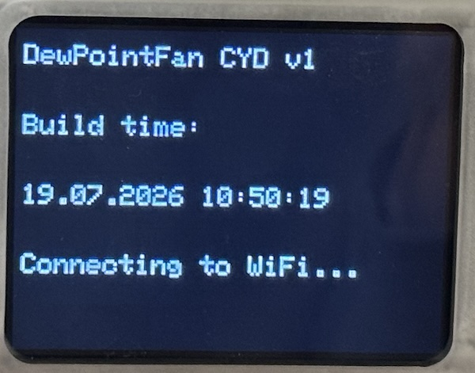
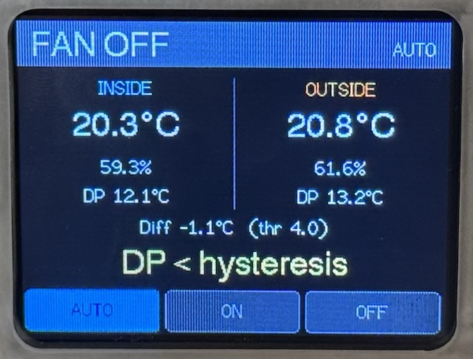
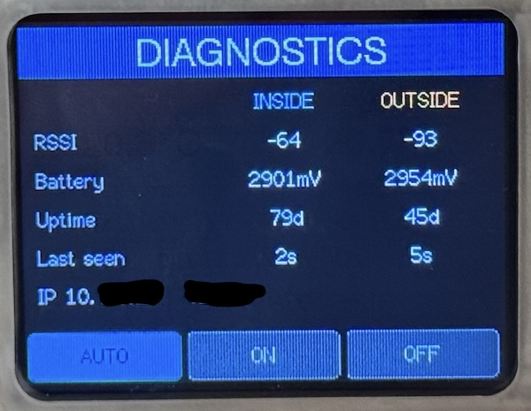
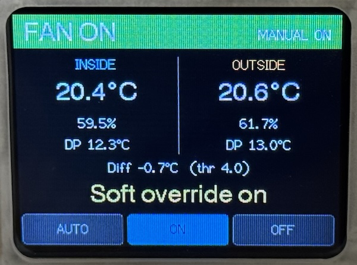

# Dew Point Fan (Cheap Yellow Display version)

This is a port of the [Dew point fan (Bluetooth version)](https://github.com/aluedtke7/dew-point-fan-bt) 
for the ESP32 **Cheap Yellow Display** (CYD, `ESP32-2432S028R`), written in **Arduino/C++** with PlatformIO.

It reads temperature and humidity from two Bluetooth-LE **ThermoBeacon** (Brifit
WS02) sensors — one inside, one outside — computes each dew point and switches
a ventilation fan on only when the outside air is drier (lower dew point) than
inside. The fan is switched over a **Shelly Plug M Gen3** using WiFi (see
[Fan control via a Shelly Plug M Gen3 (WiFi)](#fan-control-via-a-shelly-plug-m-gen3-wifi)).
A hysteresis band prevents needless switching. Status is shown on the CYD's
2.8" TFT and exposed over an HTTP API (optional) and pushed to an InfluxDB server (optional). The REST API is used by a [Flutter companion app](https://github.com/aluedtke7/dew-point-fan-app).

## Screenshots
<p float="left">
    
    
</p>
<p float="left">
    
    
</p>

The **boot screen** shows the firmware version and the build timestamp baked in at compile time,
so you can confirm at a glance which version is currently flashed.

A tap on the header line (`FAN ON/OFF` and `DIAGNOSTICS`) will toggle between the main
screen and the diagnostics screen.

A tap on the three buttons at the bottom will switch between the override mode and the
automatic (normal) mode.

## How it decides (control logic)

Dew point uses the Magnus formula (coefficients switch at 0 °C), rounded half
away from zero to 1 decimal — identical to the Go original.

The fan decision is a strict priority tree (first match wins). Temperatures,
humidities and dew points are the rolling averages of the last 20 readings per
sensor (the same values pushed to InfluxDB), so a single outlier advertisement
cannot flip the fan across the hysteresis band:

1. Manual override — `1` force ON, `2` force OFF (touch UI or HTTP `/override`)
2. Either sensor has no reading yet → OFF
3. Either sensor's reading is > 5 min old → OFF
4. Inside temp < `minTempInside` (default 10 °C) → OFF
5. Outside temp < `minTempOutside` (default −10 °C) → OFF
6. Inside humidity < `minHumidityInside` (default 30 %) → OFF
7. `dpInside − dpOutside` < `minDiff` (default 3 °C) → OFF
8. `dpInside − dpOutside` ≥ `minDiff + hysteresis` (default 4 °C) → ON
9. In the hysteresis band `[minDiff, minDiff+hysteresis)` → keep previous state

## Hardware & wiring (CYD ESP32-2432S028R)

| Function            | Pin(s)         | Notes                              |
|---------------------|----------------|------------------------------------|
| Fan (actuator)      | *none*         | Switched over WiFi (HTTP RPC), not a wired relay (see below) |
| Display ILI9341 (HSPI) | MOSI 13, MISO 12, SCLK 14, CS 15, DC 2, BL 21 | RST tied to EN; landscape 320×240 |
| Touch XPT2046 (VSPI)| CLK 25, MISO 39, MOSI 32, CS 33, IRQ 36 | **Separate SPI bus** from display  |

The base CYD has **no PSRAM** — RAM is tight. Sensor data arrives over BLE, and
the fan is switched over WiFi; **nothing is wired to the board's GPIO** .

## Fan control via a Shelly Plug M Gen3 (WiFi)

The fan is plugged into a **Shelly Plug M Gen3** on the same WiFi network as the
CYD. To switch it, the CYD calls the plug's **HTTP RPC** endpoint — a single GET
`http://<plug-ip>/rpc/Switch.Set?id=<switchId>&on=<true|false>`. No Bluetooth, no
pairing: the plug's relay just answers over the LAN. (BLE is used only to read
the ThermoBeacon sensors.)

> I started with the idea to switch the plug via BLE, but controlling a Gen3 plug from the ESP32
> over BLE proved unreliable (NimBLE v1.4.2 crashed when the BLE link dropped under WiFi radio 
> contention and I didn't test it again with v2.5.0). 
> The same `Switch.Set` RPC over WiFi is simpler, faster, and dependable, so I'm using HTTP.

Switching is **edge-triggered**: a command is only sent when the decision
actually flips, and an unreachable plug is retried (with a ~15 s backoff), not
hammered. Fan control requires `wifi.enabled` to be true and the WiFi to be up.

> **Cold-start reliability.** Right after WiFi associates (e.g. the first switch
> at boot), the very first connection to the plug can time out because the plug's
> MAC is not yet in the ESP32's ARP cache — the TCP handshake never completes and
> `HTTPClient` reports `HTTP -1` with `errno=119 (EINPROGRESS)`. To close that
> window, each `Switch.Set` is attempted a few times within one call (short timeout,
> brief pause between): the first try primes the ARP cache,
> so a follow-up connects within milliseconds. A success after a retry logs
> `[shelly] ON ok (attempt N)`. An unreachable plug still falls through
> to the caller's ~15 s backoff, and after several failed rounds, a slow periodic
> re-probe keeps trying. A transiently offline plug recovers on its own without
> needing the fan decision to flip.

### Setup

1. **Adopt the plug** in the Shelly app and join it to the **same WiFi** as the
   CYD. HTTP RPC is enabled by default (leave the web UI's *Authentication* off,
   or the plain GET will be rejected).
2. Give the plug a **stable IP** — set a DHCP reservation on your router (or a
   static IP in the plug's WiFi settings) so its address does not change.
3. Put that IP (and the switch channel — `0` on a single-relay plug) into the
   `shelly` block of `data/config.json` (see below), then flash and upload the
   filesystem:
   ```bash
   pio run -e cyd -t upload
   pio run -e cyd -t uploadfs
   ```

Verify quickly from any machine on the LAN — this is exactly what the CYD sends:

```bash
curl "http://<plug-ip>/rpc/Switch.Set?id=0&on=true"
```

Watch the serial console (`pio device monitor`): a failed command logs
`[shelly] OFF failed: HTTP <code> (...) errno=<n> (...)`, decoding the underlying
socket error so problems are diagnosable rather than silent (e.g. a negative HTTP
code = unreachable, `errno=111` = connection refused, `errno=113` = no route,
`errno=119` = cold-start ARP race — see the reliability note above; `HTTP 401` =
authentication is enabled on the plug).

### Config (`shelly` block)

```json
"shelly": {
  "enabled": true,
  "host": "192.168.0.99",
  "switchId": 0
}
```

| Key        | Meaning                                                          |
|------------|------------------------------------------------------------------|
| `enabled`  | `false` disables fan control entirely (no commands sent).        |
| `host`     | The plug's IP address. Required when `enabled`. Use a reserved IP — see the note below. |
| `switchId` | Relay channel to switch; `0` on a single-relay plug.             |

> **Use an IP address, not the plug's DNS/mDNS name.** The Shelly does have an
> mDNS hostname (e.g. `shellyplugmg3-012345678901.local`, shown/settable under
> the plug's *Settings → Network* / *Device name*), and it's tempting to put that
> in `host`. Don't: this firmware's `HTTPClient` has **no mDNS resolver**, so a
> `.local` name never resolves and every command fails. A plain (non-`.local`)
> hostname would only work if your LAN's DNS actually has a record for the plug,
> which most home routers don't create. The dependable choice is the plug's **IP
> address pinned by a DHCP reservation** on your router (or a static IP set in the
> plug's WiFi settings) so it never changes. `curl "http://<ip>/rpc/Switch.Set?id=0&on=true"`
> is the quickest way to confirm the address before putting it in `host`.

## Prerequisites (macOS)

You need three things: PlatformIO Core, a USB-to-serial driver for the CYD, and
a data-capable USB cable. All commands assume a Terminal.

### 1. PlatformIO Core (the `pio` CLI)

PlatformIO manages the ESP32 toolchain, the framework, and all `lib_deps`
automatically — you do **not** install the ESP32 SDK, compilers, or Arduino IDE
separately. It only needs Python 3.6+ (macOS ships one; or `brew install python`).

Pick one install method:

```bash
# a) Homebrew (simplest)
brew install platformio

# b) Official installer (no Homebrew)
curl -fsSL https://raw.githubusercontent.com/platformio/platformio-core-installer/master/get-platformio.py -o get-platformio.py
python3 get-platformio.py

# c) pip / pipx
pipx install platformio        # or: pip3 install --user platformio
```

If `pio` isn't found after (b)/(c), add its shims to your PATH:

```bash
export PATH="$PATH:$HOME/.platformio/penv/bin"
```

Verify: `pio --version`. Alternatively, install the **PlatformIO IDE** extension
in VS Code, which bundles Core and gives Build/Upload/Monitor buttons.

> The first `pio run -e cyd` downloads the `espressif32` platform, the Xtensa
> toolchain and the libraries (NimBLE, TFT_eSPI, XPT2046, ArduinoJson) — this
> takes a few minutes once. Subsequent builds are cached and offline.

### 2. USB-to-serial driver

The ESP32-2432S028R exposes its serial port through a USB-UART bridge chip.
Which driver you need depends on the board revision:

- **CH340 / CH340C** (most common, micro-USB boards) — install the WCH driver:
  ```bash
  brew install --cask wch-ch34x-usb-serial-driver
  ```
  (or download from the WCH website if you don't use Homebrew.)
- **CP2102 / CP210x** (some USB-C boards) — install the Silicon Labs
  [CP210x VCP driver](https://www.silabs.com/developers/usb-to-uart-bridge-vcp-drivers).

On recent macOS the CH340 driver is a system extension: after installing, go to
**System Settings → Privacy & Security**, click **Allow** for the WCH/Silicon
Labs extension, and **reboot**. On Apple Silicon you may also need to permit the
kernel extension there.

### 3. A data-capable USB cable

Many cheap cables are charge-only. Use one that carries data, plugged directly
into the Mac (avoid unpowered hubs).

### Verify the board is detected

Connect the CYD via USB and list serial devices:

```bash
ls /dev/cu.*
# expect one of:
#   /dev/cu.usbserial-XXXX      (CH340)
#   /dev/cu.wchusbserialXXXX    (CH340, newer driver)
#   /dev/cu.SLAB_USBtoUART      (CP210x)
# or:  pio device list
```

If nothing new appears, the driver isn't loaded (recheck Privacy & Security /
reboot) or the cable is charge-only. PlatformIO auto-detects the port; if you
have several devices, pin it with `--upload-port /dev/cu.usbserial-XXXX` (same
flag works for `pio device monitor`).

If an upload fails to sync, lower `upload_speed` in `platformio.ini` (e.g. to
`460800`); the CYD normally auto-resets into the bootloader, but some boards
need the **BOOT** button held while upload starts.

## Build, flash and test

With the prerequisites above in place:

```bash
# Run unit tests for the pure logic (no board needed)
pio test -e native

# Build / flash the firmware
pio run -e cyd -t clean   # remove build artifacts
pio run -e cyd
pio run -e cyd -t upload

# Upload config.json (and other data/) to the LittleFS partition
cp data/config_sample.json data/config.json     # then edit MACs/thresholds etc.
pio run -e cyd -t uploadfs

# Serial console
pio device monitor
```

### Over-the-air (OTA) updates

Once a USB flash has installed the OTA responder and the board is on WiFi
(`wifi.enabled: true`), later updates can go over the air — no USB needed. The
device advertises itself over mDNS as `dpf-cyd.local` (see `upload_port` in the
`[env:cyd_ota]` section of `platformio.ini`; use the IP instead if mDNS is
unavailable). It also registers the same name as its **DHCP hostname**, so it
appears as `dpf-cyd` in the router's client list.

```bash
pio run -e cyd_ota -t upload      # flash the firmware over WiFi
pio run -e cyd_ota -t uploadfs    # push data/ (config.json) over WiFi
```

If `ota.password` is set in `config.json`, add 
```
[env:cyd_ota]
upload-flags =
  --auth=<password>
```
in `platformio.ini` under the `env:cyd_ota` label. BLE is stopped for the 
duration of the transfer (to free RAM on this no-PSRAM board). The device 
reboots into the new image when it finishes.

## Configuration (`data/config.json`)

Copy `data/config_sample.json` to `data/config.json` (git-ignored — it holds your sensor MACs 
and any WiFi/InfluxDB secrets) and edit it. Validated ranges: `minDiff` 1 .. 10, `hysteresis` 0.1 .. 5,
`minHumidityInside` 30 .. 70, `minTempInside` 10 .. 40, `minTempOutside` −20 .. 20, 
MACs exactly 17 chars. Invalid config shows an error screen and halts control. 
The `shelly` block (the WiFi fan plug) is documented under
[Fan control via a Shelly Plug M Gen3 (WiFi)](#fan-control-via-a-shelly-plug-m-gen3-wifi).

Backlight (all under `ui`): `brightness` 0 .. 100 (normal level), `dimLevel` 0 .. 100
(dimmed level), `dimTimeout` 0 .. 3600 s (idle seconds before dimming; **0 = never
dim**). When it dims, any touch restores full brightness — and that first "wake"
tap is consumed, so it does not also switch screens or change the override.

`wifi.networks` is an **array** of `{ "ssid", "password" }` entries. If you list
more than one, the device scans on boot and connects to the one with the strongest
signal; with a single entry it connects directly. `wifi.enabled` must be `true`.

`timezone` (top level) is an IANA name such as `Europe/Berlin` or a raw POSIX TZ
string. It is applied to the NTP-synced clock so the on-screen "last seen" time and
the HTTP `/info` timestamps are local (DST included). Empty → UTC. A fixed set of
common IANA names is mapped to POSIX DST rules on-device (Berlin/Paris/Madrid/Rome,
London/Dublin, and the major US zones); any other value is passed through unchanged,
so a raw POSIX TZ string is also accepted.

## Time, NTP & timezone

When `wifi.enabled` is true, the device syncs UTC from NTP (`pool.ntp.org`) on
connect, then applies `timezone` via the `TZ` environment variable so `localtime()`
reports local wall-clock time including DST. `SensorData.scanned` is stored as UTC
epoch seconds; the `/info` API's `scanned`/`update` fields are formatted in local
time (see the [HTTP server](#http-server) section).

Until NTP has set the clock, freshness/age math uses a huge sentinel "now" so every
reading looks stale and the **fan is not switched** — control only starts once the
wall clock is valid.

**Log timestamps across a reboot.** Each `/logs` line is stamped when it is written,
using the clock. After a **soft reset or OTA reboot** the ESP32's RTC keeps running,
so lines logged during early boot already show a valid time — but in **UTC**, 
because the `TZ` environment variable is reset by the reboot and is only re-applied
when `ntpSync()` runs. That is why the log flips from UTC to local time exactly at
the `[ntp] synced` line. After a **cold power-on** the RTC has no time yet, so those
early lines read `00.00.00 00:00:00` until NTP syncs.

**Every log line also carries three heap-metrics** (`heap=X min=Y blk=Z`):
- **heap** — current free heap in bytes (`ESP.getFreeHeap()`).
- **min** — lifetime low-watermark of free heap (`ESP.getMinFreeHeap()`). The best
  slow-leak indicator: if it keeps falling across restarts, you have a leak.
- **blk** — largest contiguous free 8-bit block
  (`heap_caps_get_largest_free_block(MALLOC_CAP_8BIT)`). If `heap` stays high
  but `blk` shrinks, the heap is fragmenting.
These are queried on every `logf()` call (cheap, safe from any FreeRTOS task) and
additionally logged once per hour as a `[heap] periodic report` line, giving a
regular beat of memory data even when no other logging occurs.

## HTTP server 
### API (when `wifi.enabled` is true)

- `GET /` — plain-text status summary
- `GET /info` — JSON snapshot of both sensors + fan state + override. `scanned` and `update`
  are wall-clock timestamps rendered in the configured `timezone`.
- `POST /override` — body `{"override": 0|1|2}` (0 = auto, 1 = force on, 2 = force off)
- `GET /logs` — plain-text dump of the most recent (up to 50) log lines, each prefixed with
  a `dd.MM.yy HH:mm:ss` timestamp (see [Time, NTP & timezone](#time-ntp--timezone) for how pre-sync lines are stamped).

This API is used by the companion app [`dew-point-fan-app`](https://github.com/aluedtke7/dew-point-fan-app), to read and control this device from remote.

### InfuxDB (when `wifi.enabled` and `influx.enabled` both are true)
Every Minute (see `kInfluxIntervalMs`), the averaged values are pushed to the configured InfuxDB server.

## Project layout

```
lib/dewpoint/           pure logic, host-testable, NO Arduino/NimBLE/TFT includes
  beacon                WS02 18-byte payload parser + uptime formatting
  config                RawConfig -> validated Config (range checks)
  control               fan decision tree
  dp_math               dew point calculation + half-away-from-zero rounding
  format                value/unit dashboard screen-string formatting
  library.json          PlatformIO library manifest (build/deps for the pure lib)
  log_buffer            fixed-capacity ring buffer of recent log lines (backs /logs)
  sensordata            structs, Reason enum, rolling-average ring buffer
  shelly_rpc            Switch.Set request path + edge/backoff send decision
src/                    device firmware (the only place that includes <Arduino.h>)
  app.h                 shared App state (config, sensors, stores, result, override)
  main.cpp              setup()/loop() cooperative millis() scheduler
  hardware/             
    backlight           PWM LCD backlight + auto-dim fade
    ble_scanner         NimBLE passive observer (fills the store via callback)
    config_fs           LittleFS reader -> RawConfig
    display_tft         TFT_eSPI dashboard + diagnostics screens
    logging             logf(): timestamped serial + mutex-guarded ring buffer
    net                 WiFi (multi-network), HTTP API, InfluxDB, NTP + timezone
    net_task            network control task (core 0): Shelly RPC + InfluxDB push, off loop()
    ota                 ArduinoOTA / espota responder
    shelly              Shelly Plug HTTP RPC client (WiFi fan switch)
    touch               XPT2046 touch (VSPI), tap zones
  data/
    config.json         your config (git-ignored; holds MACs + secrets)
    config_sample.json  template to copy from
test/                   Unity test suites (run under env:native), one dir per module
  test_beacon           beacon parser + uptime formatting
  test_config           config validation / ranges
  test_control          fan decision tree
  test_dp_math          dew-point math + rounding
  test_format           screen-string formatters + log timestamp
  test_log_buffer       recent-log ring buffer
  test_sensordata       ring buffer / averaging
  test_shelly_rpc       edge/backoff send decision
```

## Libraries

- NimBLE-Arduino (passive BLE observer — half the RAM of stock Bluedroid)
- TFT_eSPI (configured via `build_flags`, not `User_Setup.h`)
- XPT2046_Touchscreen (on its own VSPI bus)
- ArduinoJson
- LittleFS (config)

### CYD gotchas (see inline comments)

- Touch is on **VSPI**, display on **HSPI** — never enable TFT_eSPI's `TOUCH_CS`.
- **BLE manufacturer data**: NimBLE returns the
  full **20-byte** frame — a 2-byte company id followed by the 18-byte WS02
  payload the pure `parseWS02` expects. `ble_scanner.cpp` strips the leading
  2 bytes before parsing. Set `DPF_BLE_DEBUG 1` there to log each beacon's
  `mfgLen` / payload MAC when onboarding a new sensor.
- **No name filter.** Under passive scan the advertised name is empty
  (`name=''`), so sensors are matched purely by the MAC embedded in the payload.
  Put the exact `payloadMAC` the debug log prints into `config.json`.
- **WiFi + BLE coexistence** on no-PSRAM: enable WiFi only after checking free
  heap (`ESP.getFreeHeap()`) and that BLE keeps updating while associated.
- Touch tap-zone thresholds are approximate — calibrate on the device to your needs.
- **Phantom taps (touch noise).** The XPT2046 library's own `touched()` gate
  (pressure `Z >= 400`) is too low on many CYD boards: electrical noise spikes
  cross it and register as real taps — typically clustered near the bottom-right
  "Off" button, which silently forced the override OFF. `touch.cpp` therefore adds
  an app-level pressure gate (`kMinPressure`, default 600): reads below it are
  rejected as noise (without consuming the next genuine press). At
  `CORE_DEBUG_LEVEL >= 2` each accepted tap logs its `z=` value — raise
  `kMinPressure` above any lingering phantoms, or lower it if firm taps are being
  dropped.
